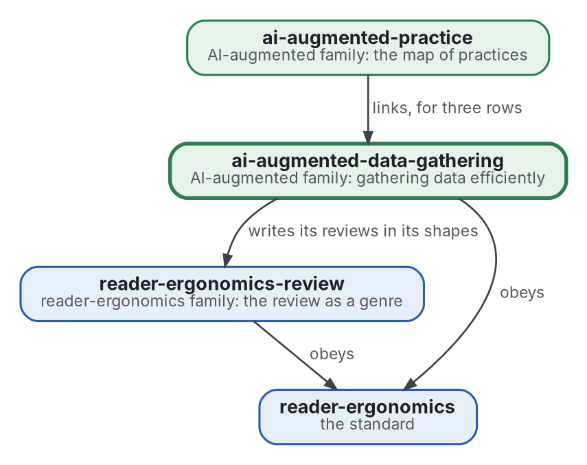

# Collecte de données

[](https://github.com/Tewf/ai-augmented-data-gathering/actions/workflows/checks.yml)
[](https://tewf.github.io/ai-augmented-data-gathering/)

La manière la plus efficace de collecter des données en général, la **quête d'information** d'abord : où chercher, quand quitter une source, comment estimer ce qui reste invisible, et quand s'arrêter. Les réponses sont écrites comme des programmes que les revues de littérature de la famille peuvent exécuter sur leurs propres journaux de recherche.

Cette page en anglais : [README.md](README.md). Les deux versions suivent le même état.

> **État (2026-11-03) :** le premier travail, une revue de littérature de premier passage sur 40 sources, est écrit et
> finit sur une référence nommée pour la règle d'arrêt. Un programme pour elle tourne sur trois protocoles de la famille ;
> leurs journaux ne contiennent pas de résultats avec concepts nouveaux, donc il n'a pas encore tourné sur un vrai
> journal. Le nom est gardé ; les noms du domaine sont quête d'information et critères d'arrêt. Ce n'est ni une norme
> officielle, ni une étude relue par des pairs, ni un résultat nouveau.
>
> **Comment il est fait :** avec Claude, un assistant IA d'Anthropic, sous la direction du mainteneur, comme
> reader-ergonomics. Les corrections sont bienvenues sous forme d'issues.

## Où il se place


<details>
<summary>Graphviz source</summary>



</details>

- **Il écrit ses revues dans les formes de [reader-ergonomics-review](https://github.com/Tewf/reader-ergonomics-review)**, la revue comme genre ; les formes sont celles de ce dépôt.
- **[ai-augmented-practice](https://github.com/Tewf/ai-augmented-practice) le lie** pour les pratiques dont l'algorithme vit ici. Il ne dépend pas de cette carte.
- **Il obéit à [reader-ergonomics](https://github.com/Tewf/reader-ergonomics/blob/2e5b6f0c3e67d2dc8195a63cf882d46170e79a5a/standard.md)** (v1.21.0) et exécute ses vérifications en CI.
- **Il ne pointe que vers le bas.** La carte de la famille est [ai-augmented](https://github.com/Tewf/ai-augmented).

## Périmètre

| | Quoi | Pourquoi |
|---|---|---|
| dedans | les modèles de quête : la parcelle, l'indice d'une source et la règle pour la quitter | la quête d'information est le nom que le domaine donne au problème, et ses modèles disent quand une source cesse de payer |
| dedans | l'estimateur d'arrêt : Good-Turing et les estimateurs de richesse d'espèces pour ce qui reste invisible | une revue qui ne peut dire ce qu'elle a manqué ne peut dire quand s'arrêter |
| dedans | le choix de la source suivante comme un bandit | chaque source est un bras au rendement inconnu, et le choix arbitre entre explorer et exploiter |
| dedans | la valeur de l'information pour une source coûteuse | une source payante ou lente ne vaut son coût que si elle peut changer la réponse |
| dedans | chacun de ces éléments comme un programme qu'une revue exécute sur son propre journal de recherche | un modèle que personne ne peut exécuter sur de vrais journaux n'est pas encore une réponse |
| plus tard | une politique unique qui choisit la source, la quitte et s'arrête | les parties d'abord ; les joindre est une affirmation à tester contre chacune seule |
| dehors | les formes de documents d'une revue | [reader-ergonomics-review](https://github.com/Tewf/reader-ergonomics-review) |
| dehors | la carte des pratiques de la méthode | [ai-augmented-practice](https://github.com/Tewf/ai-augmented-practice) |

## Le premier travail : une revue de littérature

Fait, en premier passage selon les cinq étapes d'une revue de thèse : 40 sources, 38 formelles et 2 grises, dans
[evidence/foraging-and-stopping](evidence/foraging-and-stopping/README.md). La bibliographie est
[evidence/bibliography.md](evidence/bibliography.md).

## Ce que la revue a trouvé

- **Le domaine s'appelle quête d'information pour l'ensemble, et l'arrêt a deux foyers.** En revue assistée par la
  technologie, ce sont les **critères d'arrêt** ; en écologie, l'estimation des **espèces non vues**. Le dépôt n'est pas renommé.
- **La règle de la famille est une heuristique qui a échoué à une comparaison.** Arrêter une chaîne après cinq
  résultats sans concept nouveau ressemble à s'arrêter après 50, 100 ou 200 enregistrements non pertinents.
  Cela a donné un rappel incohérent sur de vrais jeux de revues (Callaghan 2020). Mesuré, sur le tri.
  Le manuel Cochrane énumère de telles règles et dit qu'elles ont été peu évaluées formellement (Lefebvre 2025). Convention.
- **Des estimateurs de l'invisible existent et sont implémentés**, en R (iNEXT) et en Python (scikit-bio), mais les deux
  formes publiées de Chao1 diffèrent quand les doubletons sont rares. Aucune source lue ne les applique à une recherche
  bibliographique. C'est une phrase sur ce passage.
- **Les journaux de la famille ne peuvent pas nourrir un estimateur.** Aucun ne note les concepts nouveaux de chaque
  résultat ; chacun ne garde que la voie de la première trouvaille.
  Tel quel, l'estimateur donne une couverture de 0,00 à 0,05 sur trois protocoles.
  Cela découle de la forme et non des recherches. Mesuré, descriptif.
- **Une liste de concepts fixée avant la recherche certifie la liste, pas le sujet.** Cinq journaux réels ont été lus.
  Quatre avaient une liste fermée de 18 à 20 classes et atteignent une couverture de 1,00. Pourtant, entre un septième
  et un tiers de leurs résultats n'entrent dans aucune classe
  ([issue #1](https://github.com/Tewf/ai-augmented-data-gathering/issues/1)).
  Avec `--unlisted-as-concept`, un tel résultat compte comme un concept à part, vu une fois, et pèse contre la
  couverture. Mesuré, descriptif.
- **Sur des tirages aléatoires, l'estimateur s'arrête près de sa cible et la règle s'arrête tôt** : 6 % à 21 % du poids
  non vu contre 31 % à 44 % (simulation seulement).

## La référence

**L'arrêt par couverture avec Chao1 et la couverture d'échantillon de Chao-Jost, dans la forme d'iNEXT** ([baseline](evidence/foraging-and-stopping/baseline.md)).

- compter les observations de chaque concept dans le journal de recherche ;
- estimer l'invisible à partir des concepts vus une fois et deux fois ;
- s'arrêter quand la couverture estimée atteint une cible (0,95, provisoire) après au moins 30 résultats ;
- l'imprimer à côté de la règle à laquelle on la compare : arrêter une chaîne après cinq résultats sans concept nouveau.

Le programme est [checks/local/stopping_estimator.py](checks/local/stopping_estimator.py), avec 18 tests et une
[simulation](checks/local/simulate_stopping.py). La [décision](decisions/0002-coverage-stopping-is-the-baseline.md) consigne le choix.

## Questions auxquelles la revue a répondu

- **Quand s'arrêter.** En partie. Un estimateur de l'invisible est nommé et tourne, et il suit sa cible sur des tirages
  aléatoires. Savoir s'il prédit ce qu'une revue manque attend un vrai journal.
- **Où chercher.** Passé en revue : bandits et quête sont de la théorie, et aucune étude lue ne les applique au choix des sources.
- **Une source coûteuse.** Passé en revue : un indice pour options coûteuses (Weitzman 1979) et la valeur de l'information sont de la théorie seulement.
- **Les journaux.** Non. Un journal demande l'en-tête `string,result,concepts`, une ligne par résultat dans l'ordre vu
  ([ce qu'un journal doit contenir](evidence/foraging-and-stopping/on-the-family.md)).

## Vérifier

```sh
git clone https://github.com/Tewf/reader-ergonomics
python3 reader-ergonomics/checks/run.py chemin/vers/ce/depot
```

La CI exécute les mêmes vérifications à chaque push, et une exécution échoue à la première erreur
([checks.yml](https://github.com/Tewf/ai-augmented-data-gathering/blob/master/.github/workflows/checks.yml)). Chaque push sur
master construit aussi le site, [tewf.github.io/ai-augmented-data-gathering](https://tewf.github.io/ai-augmented-data-gathering/)
([pages.yml](https://github.com/Tewf/ai-augmented-data-gathering/blob/master/.github/workflows/pages.yml)).

## Contenu

| Partie | Résumé |
|---|---|
| [evidence](evidence/) | la revue sur la quête et l'arrêt, et la bibliographie |
| [checks/local](checks/local/) | l'estimateur d'arrêt, ses tests et une simulation |
| [decisions](decisions/) | une fiche par choix qui façonne ce dépôt, chacune ouvrant sur la décision en une phrase |

## Licence

Code sous [Apache License 2.0](LICENSE) ; prose sous [CC BY 4.0](LICENSES/CC-BY-4.0.txt). Réutilisez-le comme vous le
souhaitez, en créditant ce dépôt ; [CITATION.cff](CITATION.cff) donne une citation si besoin.
