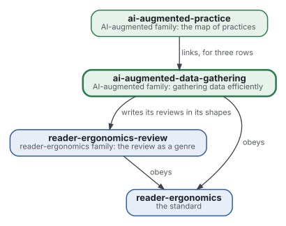
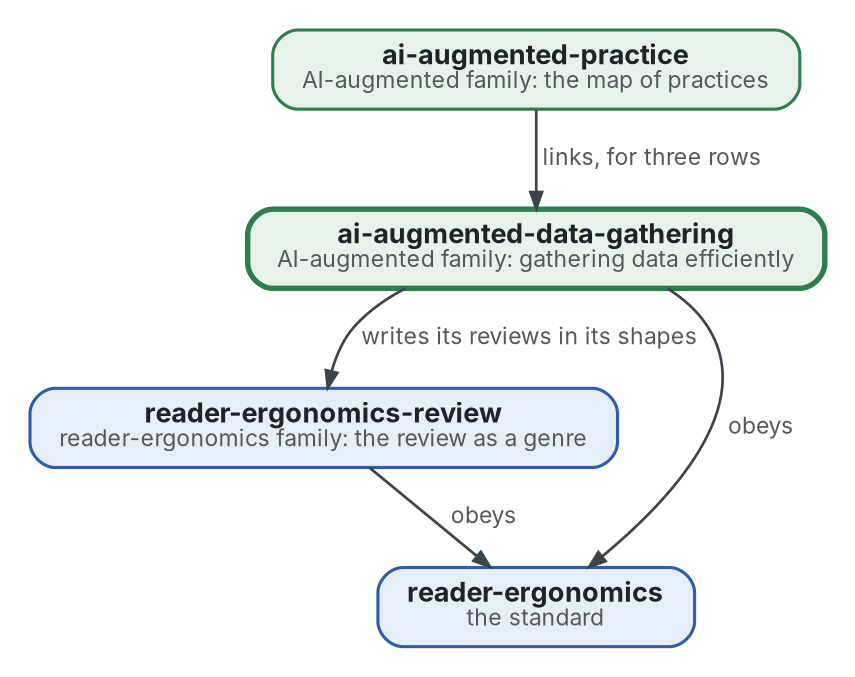

# Collecte de données

[](https://github.com/Tewf/ai-augmented-data-gathering/actions/workflows/checks.yml)
[](https://tewf.github.io/ai-augmented-data-gathering/)

La manière la plus efficace de collecter des données en général, la **quête d'information** d'abord : où chercher, quand quitter une source, comment estimer ce qui reste invisible, et quand s'arrêter. Les réponses sont écrites comme des programmes que les revues de littérature de la famille peuvent exécuter sur leurs propres journaux de recherche.

Cette page en anglais : [README.md](README.md). Les deux versions suivent le même état.

> **État (2026-11-03) :** mis en place ; rien n'est encore écrit au-delà du périmètre. Le premier travail est une revue
> de littérature, non commencée. Le nom est provisoire jusqu'à ce que la première étape de cette revue dise comment le
> domaine nomme la chose. Ce n'est ni une norme officielle, ni une étude relue par des pairs, ni un résultat nouveau.
>
> **Comment il est fait :** avec Claude, un assistant IA d'Anthropic, sous la direction du mainteneur, comme
> reader-ergonomics. Les corrections sont bienvenues sous forme d'issues.

## Où il se place



<details>
<summary>Graphviz source</summary>



</details>

- **Il écrit ses revues dans les formes de [reader-ergonomics-review](https://github.com/Tewf/reader-ergonomics-review)**, la revue comme genre ; les formes sont celles de ce dépôt.
- **[ai-augmented-practice](https://github.com/Tewf/ai-augmented-practice) le lie** pour les pratiques dont l'algorithme vit ici. Il ne dépend pas de cette carte.
- **Il obéit à [reader-ergonomics](https://github.com/Tewf/reader-ergonomics/blob/4f99372093729dacf982e9174e94f6b8793c513d/standard.md)** (v1.20.0) et exécute ses vérifications en CI.
- **Il ne pointe que vers le bas.** La carte de la famille est [ai-augmented](https://github.com/Tewf/ai-augmented).

## Périmètre

| | Quoi | Pourquoi |
|---|---|---|
| dedans | les modèles de quête : la parcelle, l'indice d'une source et la règle pour la quitter | la quête d'information est le nom que le domaine donne au problème, et ses modèles disent quand une source cesse de payer |
| dedans | l'estimateur d'arrêt : Good-Turing et les estimateurs de richesse d'espèces pour ce qui reste invisible | une revue qui ne peut dire ce qu'elle a manqué ne peut dire quand s'arrêter |
| dedans | le choix de la source suivante comme un bandit | chaque source est un bras au rendement inconnu, et le choix arbitre entre explorer et exploiter |
| dedans | la valeur de l'information pour une source coûteuse | une source payante ou lente ne vaut son coût que si elle peut changer la réponse |
| dedans | chacun de ces éléments comme un programme qu'une revue exécute sur son propre journal de recherche | un modèle que personne ne peut exécuter sur de vrais journaux n'est pas encore une réponse |
| plus tard | une politique unique qui choisit la source, la quitte et s'arrête | les parties d'abord ; les joindre est une affirmation à tester contre chacune seule |
| dehors | les formes de documents d'une revue | [reader-ergonomics-review](https://github.com/Tewf/reader-ergonomics-review) |
| dehors | la carte des pratiques de la méthode | [ai-augmented-practice](https://github.com/Tewf/ai-augmented-practice) |

## Le premier travail : une revue de littérature

Non commencée. Elle suit l'ordre d'une revue de thèse, et elle est finie quand elle peut nommer la référence.

1. **Cadrer :** le problème en une phrase, et comment chaque domaine le nomme. Pistes à vérifier : la théorie de la quête d'information (Pirolli et Card 1999), la théorie de la recherche, l'arrêt optimal et l'apprentissage actif. Le dépôt peut être renommé alors.
2. **Revue :** chaque nom, cherché par son nom académique, son acronyme et son auteur ; les synthèses d'abord.
   - les modèles de quête pour une parcelle et pour un indice, par leur nom académique et leurs auteurs, les synthèses d'abord ;
   - les estimateurs de ce qui reste invisible, de Good-Turing à la littérature de l'écologie sur la richesse d'espèces ;
   - le choix de la source suivante comme un bandit, et la valeur de l'information telle que l'analyse de décision la pose ;
   - des implémentations de référence de chacun, trouvées sous le nom des auteurs avant d'écrire qu'elles manquent.
3. **État de l'art, et le dossier contre.**
4. **Positionnement :** ce que ce dépôt demande et que le domaine ne répond pas déjà.
5. **Référence :** un programme pour l'estimateur d'arrêt, exécuté sur les journaux de recherche de la famille et comparé à la règle d'arrêt que ces revues ont suivie, que les journaux montreront.

## Questions auxquelles la revue doit répondre

- **Quand s'arrêter.** Combien de sources une revue manque-t-elle encore quand elle s'arrête, et un estimateur de l'invisible le prédit-il à partir du seul journal ?
- **Où chercher.** Choisir la source suivante comme un bandit trouve-t-il plus de sources pertinentes par recherche que l'ordre suivi par les revues ?
- **Une source coûteuse.** Quand une source payante ou lente vaut-elle son coût, comme la valeur de l'information le mesure ?
- **Les journaux.** Les journaux de recherche de la famille sont-ils tenus sous une forme qu'un programme lit, et sinon, que doivent-ils contenir ?

## Vérifier

```sh
git clone https://github.com/Tewf/reader-ergonomics
python3 reader-ergonomics/checks/run.py chemin/vers/ce/depot
```

La CI exécute les mêmes vérifications à chaque push, et une exécution échoue à la première erreur
([checks.yml](https://github.com/Tewf/ai-augmented-data-gathering/blob/master/.github/workflows/checks.yml)). Chaque push sur
master construit aussi le site, [tewf.github.io/ai-augmented-data-gathering](https://tewf.github.io/ai-augmented-data-gathering/)
([pages.yml](https://github.com/Tewf/ai-augmented-data-gathering/blob/master/.github/workflows/pages.yml)).

## Contenu

| Partie | Résumé |
|---|---|
| [decisions](decisions/) | une fiche par choix qui façonne ce dépôt, chacune ouvrant sur la décision en une phrase |

## Licence

Code sous [Apache License 2.0](LICENSE) ; prose sous [CC BY 4.0](LICENSES/CC-BY-4.0.txt). Réutilisez-le comme vous le
souhaitez, en créditant ce dépôt ; [CITATION.cff](CITATION.cff) donne une citation si besoin.
