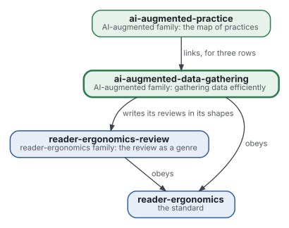
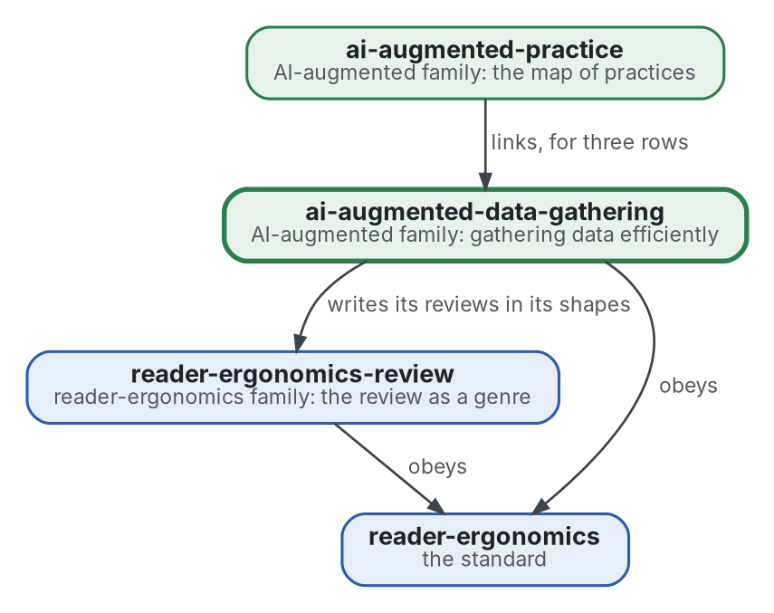

# Data gathering

[](https://github.com/Tewf/ai-augmented-data-gathering/actions/workflows/checks.yml)
[](https://tewf.github.io/ai-augmented-data-gathering/)

The most efficient way to gather data in general, **information foraging** first: where to look, when to leave a source, how to estimate what is still unseen, and when to stop. The answers are written as programs that the family's literature reviews can run on their own search logs.

This page in French: [README.fr.md](README.fr.md).

> **Status (2026-11-03):** the first job, a first-pass literature review of 40 sources, is written and ends on a named
> baseline for the stopping rule. A program for it runs on three protocols of the family; their logs hold no results
> with new concepts, so it has not yet run on a real log. The name is kept; the field's names are information foraging
> and stopping criteria. It is not an official standard, not a peer-reviewed study and not a new result.
>
> **How it is made:** with Claude, an AI assistant by Anthropic, under the maintainer's direction, the way
> reader-ergonomics was made. Corrections are welcome as issues.

## Where it sits



<details>
<summary>Graphviz source</summary>



</details>

- **It writes its reviews in the shapes of [reader-ergonomics-review](https://github.com/Tewf/reader-ergonomics-review)**, the review as a genre; the shapes are that repository's.
- **[ai-augmented-practice](https://github.com/Tewf/ai-augmented-practice) links it** for the practices whose algorithm lives here. It does not depend on that map.
- **It obeys [reader-ergonomics](https://github.com/Tewf/reader-ergonomics/blob/2e5b6f0c3e67d2dc8195a63cf882d46170e79a5a/standard.md)** (v1.21.0) and runs its checks in CI.
- **It links down only.** The family's map is [ai-augmented](https://github.com/Tewf/ai-augmented).

## Scope

| | What | Why |
|---|---|---|
| in | foraging models: the patch, the scent of a source and the rule for leaving one | information foraging is the field's name for the problem, and its models say when a source stops paying |
| in | the stopping estimator: Good-Turing and species-richness estimators for what is still unseen | a review that cannot say how much it has missed cannot say when to stop |
| in | the choice of the next source as a bandit | each source is an arm with an unknown yield, and the choice trades exploring against exploiting |
| in | the value of information for a dear source | a paywalled or slow source is worth its cost only if it can change the answer |
| in | each of these as a program a review can run on its own search log | a model nobody can run on real logs is not yet an answer |
| later | a single policy that chooses the source, leaves it and stops | the parts come first; joining them is a claim to test against each alone |
| out | the document shapes of a review | [reader-ergonomics-review](https://github.com/Tewf/reader-ergonomics-review) |
| out | the map of the method's practices | [ai-augmented-practice](https://github.com/Tewf/ai-augmented-practice) |

## The first job: a literature review

Done, as a first pass in the five steps of a thesis review: 40 sources, 38 formal and 2 grey, in
[evidence/foraging-and-stopping](evidence/foraging-and-stopping/README.md). The bibliography is
[evidence/bibliography.md](evidence/bibliography.md).

## What the review found

- **The field's name is information foraging for the whole, and stopping has two homes.** In technology-assisted review
  they are **stopping criteria**; in ecology, the estimation of **unseen species**. The repository is not renamed.
- **The family's rule is a heuristic of a kind that failed a comparison.** Stopping a string after five results with no
  new concept resembles stopping after 50, 100 or 200 irrelevant records.
  That gave inconsistent recall on real review datasets (Callaghan 2020). Measured, on screening.
  The Cochrane Handbook lists such rules and says they have had little formal evaluation (Lefebvre 2025). Convention.
- **Estimators of the unseen exist and are implemented**, in R (iNEXT) and in Python (scikit-bio), but the two published
  forms of Chao1 differ when doubletons are few. No source read applies them to a literature search. That is a
  statement about this pass.
- **The family's logs cannot feed an estimator.** None records the new concepts each result brought; each holds only
  the route that first found a source. Run as they stand, the estimator gives coverage 0.00 to 0.05 on three
  protocols, which follows from the form and not from the searches. Measured, descriptive.
- **A list of concepts fixed before the search certifies the list, not the subject.** Five real logs were read. Four
  had a closed list of 18 to 20 classes and reached coverage 1.00. Yet a seventh to a third of their results fit no
  class ([issue #1](https://github.com/Tewf/ai-augmented-data-gathering/issues/1)). With `--unlisted-as-concept`, such a
  result counts as a concept of its own, seen once, and weighs against the coverage. Measured, descriptive.
- **On random draws the estimator stops near its target and the rule stops early**: 6% to 21% of the weight unseen
  against 31% to 44% (simulation only).

## The baseline

**Coverage stopping with Chao1 and Chao-Jost sample coverage, in the form of iNEXT** ([baseline](evidence/foraging-and-stopping/baseline.md)).

- count the observations of each concept in the search log;
- estimate the unseen from the concepts seen once and twice;
- stop when the estimated coverage reaches a target (0.95, provisional) after at least 30 results;
- print it beside the rule it is compared with: stop a string after five results with no new concept.

The program is [checks/local/stopping_estimator.py](checks/local/stopping_estimator.py), with 18 tests and a
[simulation](checks/local/simulate_stopping.py). The [decision](decisions/0002-coverage-stopping-is-the-baseline.md) records the choice.

## Questions the review answered

- **When to stop.** Partly. An estimator of the unseen is named and runs, and it tracks its target on random draws. Whether it
  predicts what a review misses waits for a real log.
- **Where to look.** Reviewed: bandits and foraging are theory, and no study read applies them to choosing sources.
- **A dear source.** Reviewed: an index for costly options (Weitzman 1979) and the value of information are theory only.
- **The logs.** No. A log needs the header `string,result,concepts`, one row per result in the order seen
  ([what a log must hold](evidence/foraging-and-stopping/on-the-family.md)).

## Check it

```sh
git clone https://github.com/Tewf/reader-ergonomics
python3 reader-ergonomics/checks/run.py path/to/this/repository
```

CI runs the same checks on every push, and a run fails on any error
([checks.yml](https://github.com/Tewf/ai-augmented-data-gathering/blob/master/.github/workflows/checks.yml)). Every push to
master also renders the site, [tewf.github.io/ai-augmented-data-gathering](https://tewf.github.io/ai-augmented-data-gathering/)
([pages.yml](https://github.com/Tewf/ai-augmented-data-gathering/blob/master/.github/workflows/pages.yml)).

## Contents

| Part | Summary |
|---|---|
| [evidence](evidence/) | the review on foraging and stopping, and the bibliography |
| [checks/local](checks/local/) | the stopping estimator, its tests and a simulation |
| [skills](skills/) | the baseline as a skill an agent loads before it searches: [gather-data](skills/gather-data/SKILL.md) |
| [decisions](decisions/) | one record per choice that shapes this repository, each opening with the decision in one sentence |

## Licence

Code under the [Apache License 2.0](LICENSE); prose under [CC BY 4.0](LICENSES/CC-BY-4.0.txt). Reuse it as you wish,
with credit to this repository; [CITATION.cff](CITATION.cff) gives a citation if you need one.
