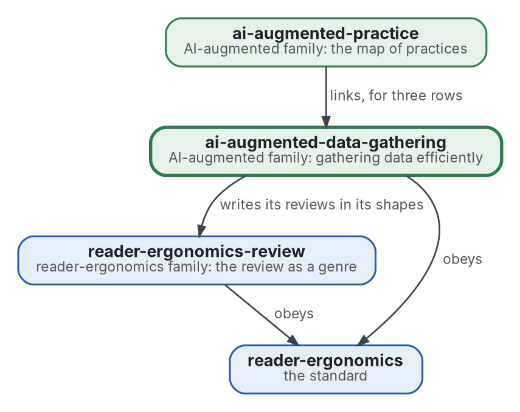

# Data gathering

[](https://github.com/Tewf/ai-augmented-data-gathering/actions/workflows/checks.yml)
[](https://tewf.github.io/ai-augmented-data-gathering/)

The most efficient way to gather data in general, **information foraging** first: where to look, when to leave a source, how to estimate what is still unseen, and when to stop. The answers are written as programs that the family's literature reviews can run on their own search logs.

This page in French: [README.fr.md](README.fr.md).

> **Status (2026-11-03):** set up; nothing is written yet beyond the scope. The first job is a literature review, not
> started. The name is provisional until that review's first step says what the field calls this. It is not an
> official standard, not a peer-reviewed study and not a new result.
>
> **How it is made:** with Claude, an AI assistant by Anthropic, under the maintainer's direction, the way
> reader-ergonomics was made. Corrections are welcome as issues.

## Where it sits


<details>
<summary>Graphviz source</summary>



</details>

- **It writes its reviews in the shapes of [reader-ergonomics-review](https://github.com/Tewf/reader-ergonomics-review)**, the review as a genre; the shapes are that repository's.
- **[ai-augmented-practice](https://github.com/Tewf/ai-augmented-practice) links it** for the practices whose algorithm lives here. It does not depend on that map.
- **It obeys [reader-ergonomics](https://github.com/Tewf/reader-ergonomics/blob/4f99372093729dacf982e9174e94f6b8793c513d/standard.md)** (v1.20.0) and runs its checks in CI.
- **It links down only.** The family's map is [ai-augmented](https://github.com/Tewf/ai-augmented).

## Scope

| | What | Why |
|---|---|---|
| in | foraging models: the patch, the scent of a source and the rule for leaving one | information foraging is the field's name for the problem, and its models say when a source stops paying |
| in | the stopping estimator: Good-Turing and species-richness estimators for what is still unseen | a review that cannot say how much it has missed cannot say when to stop |
| in | the choice of the next source as a bandit | each source is an arm with an unknown yield, and the choice trades exploring against exploiting |
| in | the value of information for a dear source | a paywalled or slow source is worth its cost only if it can change the answer |
| in | each of these as a program a review can run on its own search log | a model nobody can run on real logs is not yet an answer |
| later | a single policy that chooses the source, leaves it and stops | the parts come first; joining them is a claim to test against each alone |
| out | the document shapes of a review | [reader-ergonomics-review](https://github.com/Tewf/reader-ergonomics-review) |
| out | the map of the method's practices | [ai-augmented-practice](https://github.com/Tewf/ai-augmented-practice) |

## The first job: a literature review

Not started. It follows the order of a thesis review, and it is finished when it can name the baseline.

1. **Frame:** the problem in one sentence, and what each field calls it. Leads to verify: information foraging theory (Pirolli and Card 1999), search theory, optimal stopping, and active learning. The repository may be renamed then.
2. **Review:** each name, searched by its academic name, its acronym and its author; surveys first.
   - foraging models for a patch and for a scent, by their academic names and their authors, surveys first;
   - estimators of what is still unseen, from Good-Turing to the species-richness literature of ecology;
   - the choice of the next source as a bandit, and the value of information as decision analysis states it;
   - reference implementations of each, found under the authors' names before anything is written as missing.
3. **State of the art, and the case against.**
4. **Position:** what this repository asks that the field does not already answer.
5. **Baseline:** a program for the stopping estimator, run on the family's own search logs and compared with the stopping rule those reviews used, which the logs will show.

## Questions the review must answer

- **When to stop.** How many sources does a review still miss when it stops, and does an estimator of the unseen predict it from the log alone?
- **Where to look.** Does choosing the next source as a bandit find more of the relevant sources per search than the order the reviews followed?
- **A dear source.** When is a paywalled or slow source worth its cost, as the value of information measures it?
- **The logs.** Are the family's search logs kept in a form a program can read, and if not, what must they hold?

## Check it

```sh
git clone https://github.com/Tewf/reader-ergonomics
python3 reader-ergonomics/checks/run.py path/to/this/repository
```

CI runs the same checks on every push, and a run fails on any error
([checks.yml](https://github.com/Tewf/ai-augmented-data-gathering/blob/master/.github/workflows/checks.yml)). Every push to
master also renders the site, [tewf.github.io/ai-augmented-data-gathering](https://tewf.github.io/ai-augmented-data-gathering/)
([pages.yml](https://github.com/Tewf/ai-augmented-data-gathering/blob/master/.github/workflows/pages.yml)).

## Contents

| Part | Summary |
|---|---|
| [decisions](decisions/) | one record per choice that shapes this repository, each opening with the decision in one sentence |

## Licence

Code under the [Apache License 2.0](LICENSE); prose under [CC BY 4.0](LICENSES/CC-BY-4.0.txt). Reuse it as you wish,
with credit to this repository; [CITATION.cff](CITATION.cff) gives a citation if you need one.
