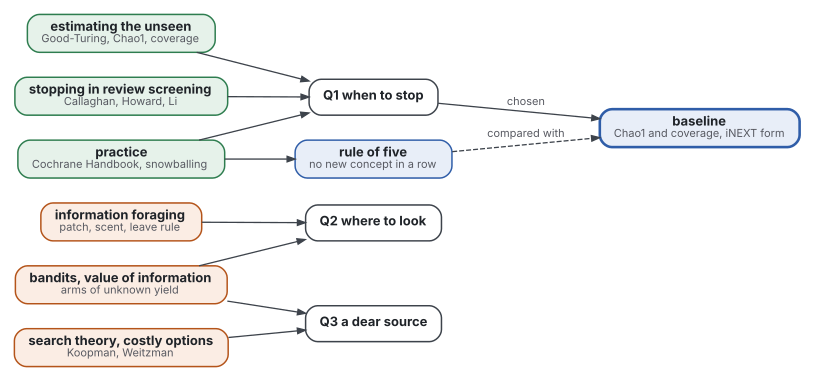
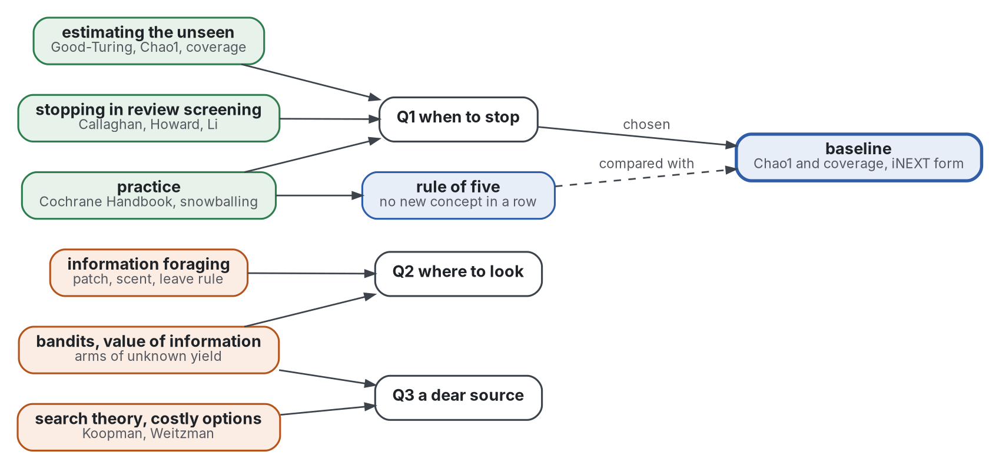

# Review: the literature, by strand

Step 2. Grades and read levels are in [sources](sources.md); the terms are in [frame](frame.md). A claim carries its grade, and "(secondary)" marks a number read in an abstract.

Graphviz source

## Strand 0: existing reviews

- Active learning has a survey (Settles 2009), located only. Its subject is choosing what to label, not when to stop.
- Species-number estimators have a review (Bunge 1993) and a recent one (Chao 2016, abstract). The abstract says simple counts of richness underestimate and depend on sampling effort. Grade: supported with caveat.
- Information foraging in software tools has a survey (Fleming 2013, abstract): it asks whether the theory's equations explain why tools work. Grade: supported with caveat.
- The Cochrane Handbook (Lefebvre 2025, read) is the practice review of stopping a search. It is a handbook, not a study.
- No review joins the unseen-species estimators to the stopping of a literature search.

## Strand 1: information foraging

- Pirolli 1999 and Pirolli 2007 set the theory: a reader forages in patches of information, guided by the **scent** of a link. Both located only. Grade: convention.
- Its rule for leaving a patch comes from foraging ecology (Charnov 1976, located only). Grade: convention, untested for reviews.
- Bates 1989 (abstract) models search as **berrypicking**, a path that changes with what is found. Grade: convention.
- The theory has been applied to programmers debugging (Lawrance 2013, located only) and to tools (Fleming 2013). No foraging study read measures a literature search.

## Strand 2: search theory and the economics of search

- Search theory started with the kinematics of finding a target (Koopman 1956, abstract).
- Bayesian search found the wreckage of Air France 447 within one week of undersea search in the third year, after two years without success (Stone 2014, abstract). Grade: measured, one case.
- Stigler 1961 sets the cost of one more look against its expected gain. Located only. Grade: convention.
- Weitzman 1979 gives an index for search where each option costs something to open. Located only. It is the form of the dear-source question (Q3). Grade: convention.

## Strand 3: optimal stopping

- Ferguson 1989 (abstract) reviews the secretary problem and its field of extensions. Grade: convention.
- No optimal-stopping source read treats a source of unknown yield whose total is also unknown.

## Strand 4: active learning and stopping in review screening

- Uncertainty sampling trains a text classifier by asking for the labels it is least sure of (Lewis 1994, located only).
- Applied to screening, it reduced the citations to screen by nearly half in two of three datasets (Wallace 2010, abstract). Grade: measured.
- **Technology-assisted review (TAR)** names the field. Its open problem is when to stop (Li 2020, abstract).
- Callaghan 2020 (read) compares stopping criteria on real systematic-review datasets.
  - Heuristic criteria stop after 50, 100 or 200 consecutive irrelevant records.
  - They gave inconsistent recall and work saved across datasets.
  - A hypergeometric test of "recall below target" reached a reliable recall with 17% work saved on average.
  - Grade: measured, on its datasets.
- Howard 2020 (abstract, secondary) models the remaining relevant records with a negative binomial. On 26 datasets, 95% of relevant articles were found after screening 40% of the list on average.
- Other methods use sampling (Li 2020), counting processes (Sneyd 2021, located only) and point processes (Stevenson 2023, abstract). Cormack 2016 is located only.
- Spoor 1996 (located only) proposed capture-recapture to judge how complete a literature search is. Grade: convention.
- Lefebvre 2025 (read) says estimating the remaining relevant records is possible, and that eliminating records on that basis is not recommended for Cochrane reviews as of mid-2023.

## Strand 5: the estimation of what is unseen

- Good 1953 (located only) gives the frequency of unseen species from the species seen once. Good and Toulmin 1956 extend it to a larger sample.
- Efron 1976 asked how many words Shakespeare knew but did not use. Gale 1995 is the practical guide to Good-Turing. Both located only.
- **Chao1** estimates the unseen from singletons and doubletons (Chao 1984, Chao 1987, located only; the formula is read in the code of Hsieh 2016 and in Scikit-bio 2026).
  - Two forms exist. iNEXT uses (n-1)/n times f1 squared over 2 f2. scikit-bio uses f1 (f1-1) over 2 (f2+1).
  - They differ whenever f2 is small, so a baseline must name its form.
- **Sample coverage** is the share of total weight seen (Chao 2012, abstract). Samples are compared at equal coverage, not equal size, because a sample may complete a poor community and not a rich one. Grade: supported with caveat.
- iNEXT (Hsieh 2016, abstract and code read) is the reference implementation of coverage. Grade: supported with caveat.
- Orlitsky 2016 (abstract, secondary) extends the classical estimate, which reaches a sample of twice the size, to about n log n.

## Strand 6: bandits and the value of information

- A **bandit** chooses among arms of unknown yield and trades exploring against exploiting. Seminal: Thompson 1933 (located only).
- Auer 2002 (located only) gives finite-time bounds. Gittins 1979 (abstract) gives an index for dynamic allocation and names a class of search problems.
- Russo 2018 (abstract) is the tutorial on Thompson sampling.
- Howard 1966 (located only) defines the value of information: what a look is worth in the decision it can change.
- None of these sources was read applied to choosing sources for a literature review.

## Strand 7: practice

- The Cochrane Handbook (Lefebvre 2025, read, section on when to stop) lists stopping suggestions.
  - Stop if added search terms yield no new relevant record.
  - Stop if precision falls below a cut-off.
  - It says the approaches have had little formal evaluation. Grade: convention.
- Wohlin 2014 (located only) is the guideline for snowballing, which stops when a round finds nothing new.
- Garousi 2019 names saturation as a stopping rule for grey searches and is the method of this review.
- Reference implementations: iNEXT (R), scikit-bio (Python), rapid-screening (Callaghan 2020, code located), and the code of Sneyd 2021. None reads a review's search log.
